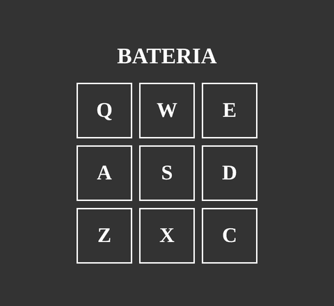

# Bateria

Bateria virtual no navegador: aperte as teclas do teclado e toque um som diferente em cada uma. Feita com HTML, CSS e JavaScript puro.

🔗 **Demo:** [evssousa.github.io/bateria](https://evssousa.github.io/bateria/)

<p align="center">
  
</p>

## Como usar

Abra a demo e aperte as teclas do teclado:

| | | |
| :---: | :---: | :---: |
| **Q** | **W** | **E** |
| **A** | **S** | **D** |
| **Z** | **X** | **C** |

Cada tecla toca um som e a caixa correspondente na tela acende em amarelo por um instante. Dá para apertar a mesma tecla várias vezes seguidas: o som reinicia a cada toque.

> O projeto funciona com o teclado, então é pensado para computador.

## Funcionalidades

- 9 teclas, cada uma com seu próprio som
- Feedback visual: a tecla pressionada fica amarela por 200 ms
- Som reiniciado a cada toque, permitindo repetir a mesma tecla rapidamente
- Sem bibliotecas nem dependências

## Tecnologias

- **HTML5**: estrutura e elementos `<audio>` para os sons
- **CSS3**: layout com Grid, variáveis CSS e estilo das teclas
- **JavaScript (puro)**: eventos de teclado e manipulação do DOM

## Estrutura do projeto

```
bateria/
├── assets/
│   ├── css/
│   │   └── style.css    # estilos e variáveis de cor
│   ├── js/
│   │   └── script.js    # captura das teclas e reprodução dos sons
│   └── sounds/          # arquivos .wav (um por tecla)
├── img/
│   └── preview.gif      # animação usada neste README
├── index.html           # estrutura da página
└── README.md
```

## Como rodar localmente

Não precisa instalar nada. Clone o repositório e abra o arquivo no navegador:

```bash
git clone https://github.com/evssousa/bateria.git
cd bateria
```

Depois, abra o `index.html` no navegador (duplo clique no arquivo ou, no VS Code, use a extensão Live Server).

## Como funciona

1. Cada tecla da tela é uma `<div>` com um atributo `data-key` (por exemplo, `keyq`), e cada som é um `<audio>` com a classe correspondente (`s_keyq`).
2. O `script.js` escuta o evento `keyup` e usa `event.code` em minúsculo (`KeyQ` vira `keyq`) para descobrir qual tecla foi solta.
3. A função `playSound()` usa esse nome para encontrar o áudio e a tecla na tela. Ela volta o áudio para o início (`currentTime = 0`), toca o som, adiciona a classe `active` à tecla e a remove depois de 200 ms.

Ligar tecla, som e elemento visual pelo mesmo nome é o que permite adicionar novos sons sem mexer na lógica do JavaScript.

## Ideias de melhorias futuras

- Tocar também com clique do mouse e toque na tela, para funcionar no celular
- Usar `keydown` em vez de `keyup`, para o som sair no momento em que a tecla é apertada
- Concluir o "compositor" (campo de texto + botão **Tocar**) que já está esboçado no código, para tocar sequências de teclas digitadas
- Carregar a fonte Roboto (hoje ela é pedida no CSS, mas não é importada)
- Mais teclas e mais sons

## Autor

**Everson Sousa**, Análise e Desenvolvimento de Sistemas

[](https://github.com/evssousa)
[](https://linkedin.com/in/evssousa)
